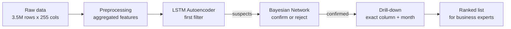

# Pension Payment Anomaly Detection

**LSTM Autoencoder + Bayesian Network + Drill-down**

Master's thesis project (PFE) carried out with a banking institution.

The goal is to detect anomalies in clients' monthly pension payments **before the payment is sent**. Catching errors early means fewer client complaints and fewer corrections after the fact.

> **Note on data:** the data belongs to the bank and is confidential. This repository contains only the code and anonymized results. No client data, client IDs or trained models are shared.

---

## The problem

Each month, every client's pension is computed from dozens of financial items: gross amounts, health insurance contributions, deductions, income tax, family allowances, refunds and so on. When one of these items is wrong, the client usually notices only after receiving the payment, and then files a complaint.

Checking every client by hand is impossible at this scale, so the idea was to build a pipeline that:

1. scans all clients automatically,
2. keeps only the cases that are really suspicious,
3. tells the business expert **exactly where** the problem is: which financial variable, which month, and how severe.

## Data

| | |
|---|---|
| Rows | ~3.5 million |
| Columns | 255 |
| Clients | ~153,000 |
| History | up to 17 months per client |

Each row is **one client in one month**, so each client is a short time series. The columns are financial variables: the detailed items (`brut_*`, `mutu_*`, `cont_*`, `prel_*`, …) and a few single-column items such as income tax (`ir_9999`) and family allowance (`af_20000`).

## Pipeline



The three stages work as a cascade: the LSTM is a broad filter over all clients, the Bayesian network only looks at what the LSTM flagged, and the drill-down only runs on confirmed anomalies.

### 1. Preprocessing (`src/Preprocessing.py`)

- Memory optimization (float64 → float32, int64 → int32) since the dataset is large.
- Missing values in numeric columns replaced by 0.
- **Feature engineering:** the detailed columns are summed into aggregated totals:
  `TOTAL_BRUT`, `TOTAL_MUTU`, `TOTAL_CONT`, `TOTAL_PREL`, `TOTAL_REMB`.
- Ratios relative to the gross amount: `Ratio_Mutu`, `Ratio_cont`, `Ratio_prel`, `Ratio_ir`.
- Monthly aggregation per client and payment category. When a client has several lines in the same month (or a line not starting on the 1st), the month is flagged `is_aggregated = 1` and excluded from detection.
- `time_idx`: time index per client, used to order the sequences.

The models work on the **aggregated** features. The original detailed columns are kept aside for the drill-down.

### 2. LSTM Autoencoder (`src/LSTMAE.py`)

The first filter. The autoencoder learns what a "normal" pension history looks like and flags months it cannot reconstruct well.

- **Input:** one sequence per client, up to 17 months, 10 features (6 totals + 4 ratios).
- **Scaling:** `log1p` + `RobustScaler` fitted on the train set only, clipped to [-3, 3]. Zeros are kept as zeros.
- **Padding + mask:** shorter histories are left-padded, and a mask makes sure padding is ignored in the loss and in detection.
- **Architecture (PyTorch):**
  - Encoder: 2-layer LSTM (64 units) → linear layer to a 32-dim latent vector
  - Decoder: latent vector repeated over time → 2-layer LSTM (64 units) → linear output
- **Training:** masked MSE loss, Adam (lr = 0.001), learning-rate scheduler, early stopping (patience 5), gradient clipping.
- **Split by client** (70 / 10 / 20), so test clients are never seen during training.
- **Detection:** absolute reconstruction error per variable and per month. A month is suspicious when the error is above the **99th percentile** threshold of that variable.

Detection is done on 6 variables: `TOTAL_BRUT`, `TOTAL_MUTU`, `ir_9999`, `TOTAL_CONT`, `TOTAL_PREL`, `af_20000`.

### 3. Bayesian Network (`src/RB_pipeline_final.py`)

The second filter. It only looks at the suspects from the LSTM and either **confirms** or **rejects** each one, to filter out the false positives of the first stage.

- **One network per variable** (6 networks), built with `pgmpy`.
- **DAG built from business rules**, not learned from data. For example, income tax depends on gross pay, health insurance, contributions and deductions; deductions depend on gross pay; gross pay depends on the payment category.
- **Nodes:** discretized value of the variable (5 levels), discretized month-to-month change (strong drop → strong rise), payment category, and the parent variables defined by the DAG.
- **Target node `ANOMALIE`:** labelled with business rules on the client's own history. A month counts as an anomaly when there is a spike compared to the client's median (IQR-based z-score and deviation thresholds, confirmed by neighbouring months), or, for health insurance, when a payment **suddenly disappears or appears**.
- **CPTs** learned with Maximum Likelihood (Bayesian estimator with BDeu prior as a fallback).
- **Inference:** Variable Elimination gives `P(ANOMALIE | evidence)` for each suspect month, with a cache to make it fast.
- **Decision:**
  - stable series (low coefficient of variation) are skipped,
  - an **adaptive threshold** per client: mean + 2.5 × std of its probabilities, bounded between 0.45 and 0.80,
  - **final score** = BN probability × normalized deviation from the client's median,
  - a month is confirmed when the probability is above the adaptive threshold, a spike is present and the final score ≥ 0.30.
- **Severity levels** from the final score: *Faible* (low, ≤ 0.40), *Modéré* (moderate, ≤ 0.70), *Élevé* (high, > 0.70).

### 4. Drill-down (in `src/inference.py`)

The last step. The models work on totals, but the business expert needs to know **which exact column** caused the problem.

For each confirmed anomaly (e.g. `TOTAL_PREL` in March), the drill-down goes back to the detailed columns (`prel_*`) for that client and month and compares each one to its historical median. The columns with the largest deviation are reported as the source. Each one is classified as:

- **Nouveau paiement:** a payment that did not exist before
- **Paiement disparu:** a payment that stopped
- **Spike élevé:** deviation above 100%
- **Variation anormale:** smaller but abnormal deviation

**Final output, one line per anomaly:** client, aggregated variable, source column, month, value vs. historical median, deviation %, anomaly type, final score and severity level.

## Results

- Around **153,000 clients** analyzed over 17 months.
- At the end of the pipeline, about **1.2%** of cases are flagged as anomalies, ranked by score.
- Each flagged case comes with its exact variable, month and score, so the expert knows where to look instead of checking the whole file.

### Examples of detected anomalies

*All examples are anonymized: no client ID or personal information is shown. The red cross marks the anomalous month and `s` is the final anomaly score.*

| | |
|:---:|:---:|
| |
| **New payment:** `cont_745` was always 0, appeared in 02/2026, then disappeared. Score 0.95 (Élevé).|
|  | 
| **[Type]:** short description. Score X (level).|
### How the results are used

The pipeline **does not decide** anything on its own. The flagged cases go to the business experts, who start with the highest scores and verify each client's supporting documents before the payment is sent.

In practice, two kinds of cases come out:

- **real errors**, which are corrected before the client receives the payment;
- **justified changes** (for example, a legitimate change of payment method), which are statistically unusual but correct.

This is expected. The goal is not to replace the expert but to give a short, ranked list with the exact location of each problem.

## Repository structure

```
pension-anomaly-detection/
├── README.md
├── requirements.txt
├── src/
│   ├── Preprocessing.py       # cleaning, feature engineering, monthly aggregation
│   ├── LSTMAE.py              # LSTM autoencoder: training + detection
│   ├── RB_pipeline_final.py   # Bayesian networks: training + confirmation
│   └── inference.py           # full pipeline: LSTM -> BN -> drill-down
└── docs/
    └── images/                # anonymized result figures
```

## How to run

The project was developed and run on **Kaggle** (GPU). The data is not included, so the code cannot be run as is. The steps would be:

```bash
pip install -r requirements.txt
```

1. Put the data in `data/data.parquet`.
2. Run the preprocessing:
```python
   from src.Preprocessing import run_preprocessing
   df_model, df_original = run_preprocessing()
```
3. Train the LSTM autoencoder (`run_lstm_ae_pipeline(df_model)` in `LSTMAE.py`) and the Bayesian networks (`train_rb(df_model)` in `RB_pipeline_final.py`). Models are saved in `models/`.
4. Run the full pipeline:
```python
   from src.inference import run_inference
   df_lstm, df_rb, df_drilldown = run_inference(df_model, df_original)
```

Paths are set at the top of each file.

## Tech stack

Python · PyTorch · pgmpy · scikit-learn · pandas · NumPy · Kaggle

## Author

Master's thesis (PFE). The pipeline was designed and developed individually.
